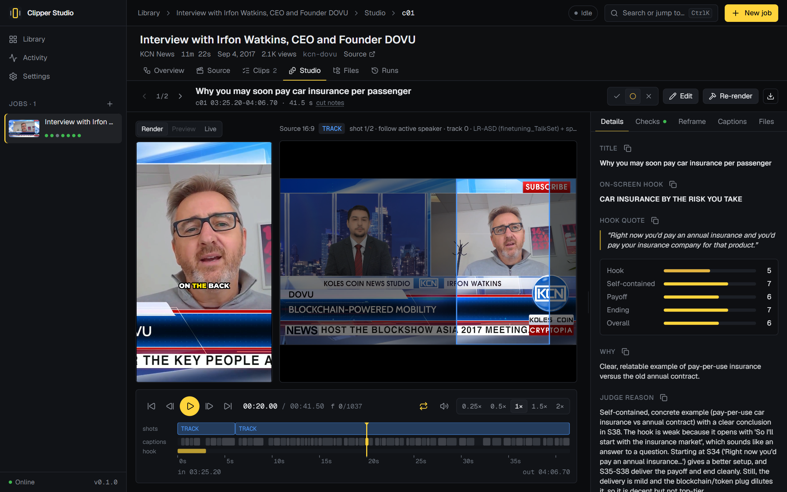
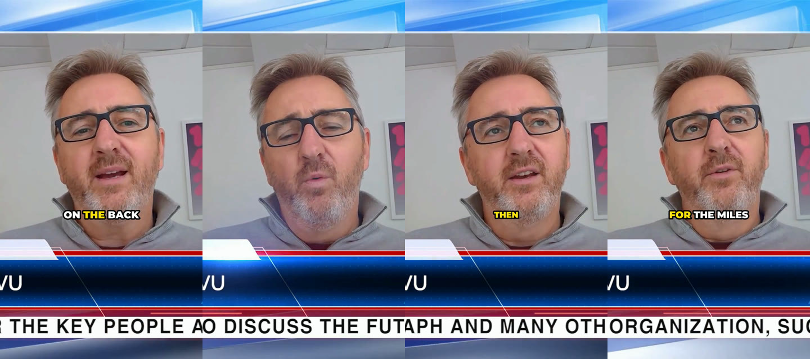
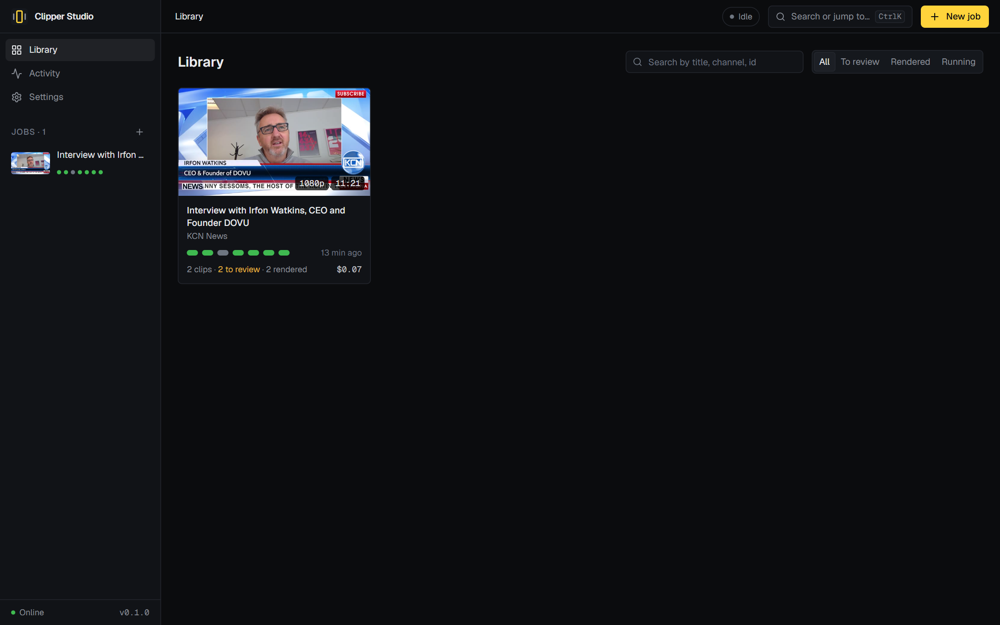
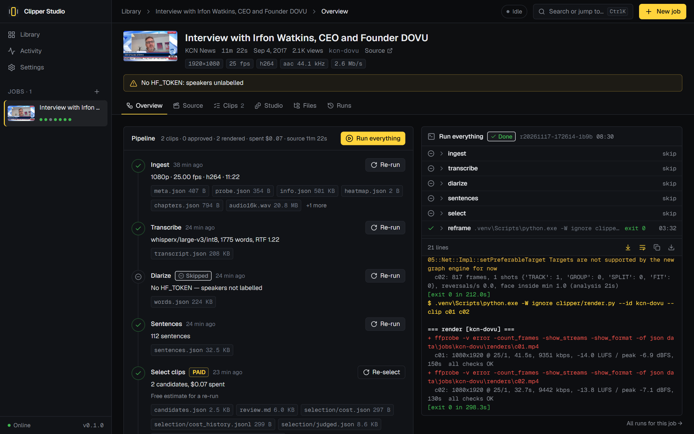
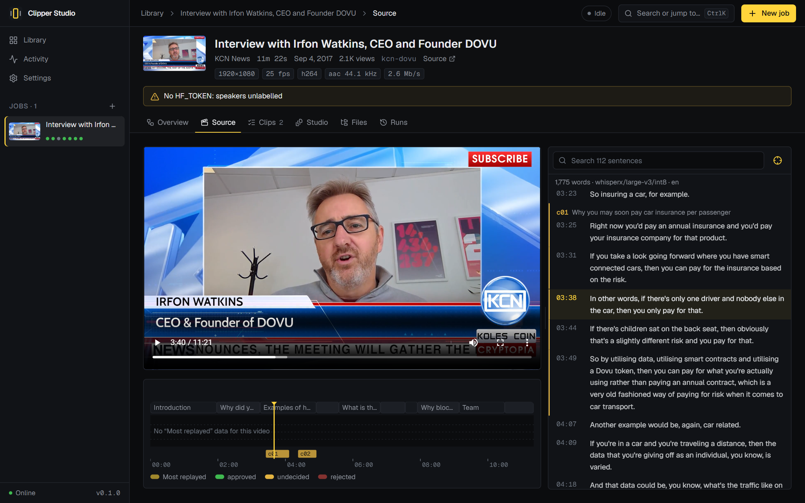
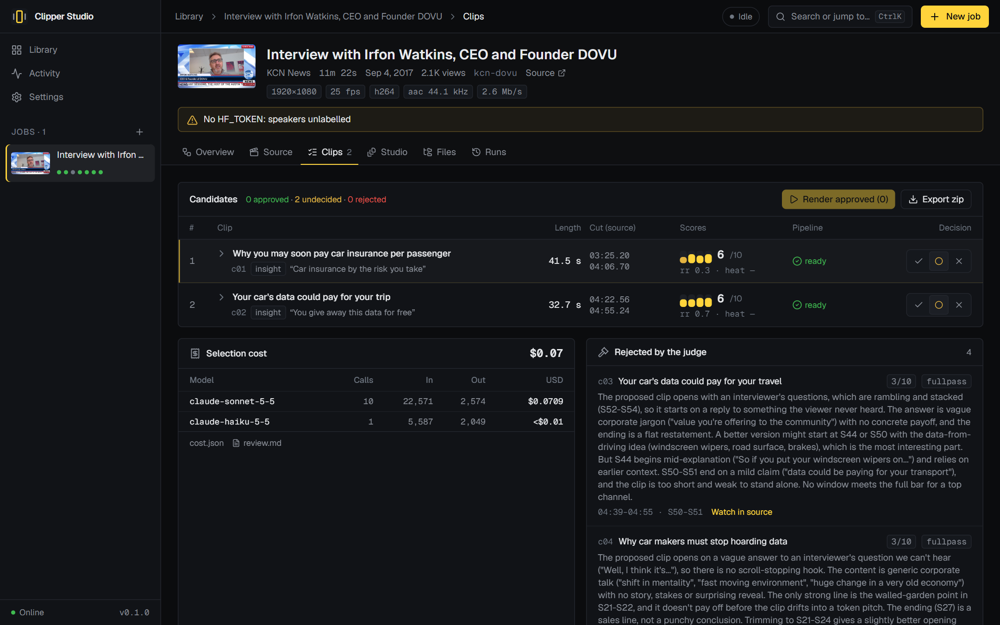
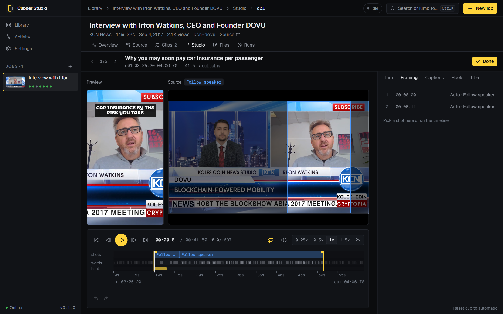

# AI Video Clipper

Turn a long YouTube video (podcast, interview, talk) into finished vertical clips for Shorts, TikTok and Reels:
picked by AI, framed on whoever is speaking, captioned word by word, loudness-matched, rendered once at full quality.
Everything runs on a normal laptop CPU; the only paid step is clip selection (about $0.10 per 10 minutes of video).



## What you get



- **1080×1920 at the source frame rate**, H.264 CRF 16, encoded once from the original download.
- **Speaker-aware framing**: faces are tracked per shot and an audio-visual model (LR-ASD) decides who is talking,
  so the crop follows the speaker, splits the screen when two people talk, and never whip-pans.
- **Word-timed captions** with the spoken word highlighted, kept inside every platform's safe zone.
- **Clean edges**: cuts land in silences and on camera cuts, so no clipped words and no flash of the previous shot.
- **Consistent loudness**: −14 LUFS, true peak ≤ −2 dBTP. Every render is checked automatically.

## Clipper Studio

A local web app that runs the pipeline and shows everything it does: every stage, the exact command, live logs,
every file, costs and quality checks.

| | |
|---|---|
|  |  |
| **Library**: every video and how far it got. | **Overview**: the 7 stages, their outputs, and the live log. |
|  |  |
| **Source**: chapters, "Most replayed", and a transcript you can click to seek. | **Clips**: why each clip was picked, scores, cost, and what the AI judge rejected. |

**Edit after generation.** Press *Edit* in the Studio to trim (snaps to word gaps), change the framing of any
shot (follow speaker, fixed crop, group, split, full frame) with a live 9:16 preview, fix or hide caption words,
change the on-screen hook or the title. Save, then render.



## How it works

```
YouTube URL ─► yt-dlp (best quality, verified) ─► WhisperX transcript + word timings ─► sentences
          ─► Claude: Haiku scans windows, Sonnet reads the whole video, Sonnet judges and ranks (PAID, estimate first)
          ─► reframe: shot cuts, YuNet faces, tracking, LR-ASD active speaker, layout per shot, smooth camera path
          ─► render: one encode with captions (libass, Montserrat) and two-pass loudness normalisation
```
Every stage writes a file you can inspect in `data/jobs/<id>/`, so any stage can be re-run on its own.
Design decisions and tool comparisons are in [`research/`](research/); the UI and API spec is
[`docs/UI_SPEC.md`](docs/UI_SPEC.md).

## Setup (Windows, Python 3.12, Node 22+, ffmpeg on PATH)

```bash
python -m venv .venv
.venv/Scripts/python -m pip install torch==2.8.0 torchaudio==2.8.0 --index-url https://download.pytorch.org/whl/cpu
.venv/Scripts/python -m pip install -r requirements.txt
git clone --depth 1 https://github.com/Junhua-Liao/LR-ASD vendor/LR-ASD
mkdir models
curl -L -o models/face_detection_yunet_2023mar.onnx https://media.githubusercontent.com/media/opencv/opencv_zoo/main/models/face_detection_yunet/face_detection_yunet_2023mar.onnx
cd web && npm install && npm run build && cd ..
```
yt-dlp also needs [Deno](https://deno.com) for YouTube. Copy `.env.example` to `.env` and add:
- `ANTHROPIC_API_KEY` for clip selection (paid; the app always shows a free estimate and asks before spending).
- `HF_TOKEN` (optional, free) to label speakers with pyannote; accept the terms of
  `pyannote/speaker-diarization-community-1` first.

## Run

Double-click **`Clipper Studio.cmd`**, or `.venv/Scripts/python -m server`, then open http://127.0.0.1:8765.
The app only listens on your own machine. New job → paste a link → *Select clips* → *Run everything* → review and
download from the Studio. Command-line equivalent: `.venv/Scripts/python clipper/run.py <url> --id myjob --select`
(see [`clipper/README.md`](clipper/README.md)).

Development: `pytest server/tests` (server), `npm run dev` / `npm run lint` in `web/` (interface).

## Credits

- Demo footage in the screenshots: ["Interview with Irfon Watkins, CEO and Founder DOVU"](https://www.youtube.com/watch?v=3H08miqi8us)
  by KCN News, licensed under [Creative Commons Attribution (CC BY)](https://creativecommons.org/licenses/by/3.0/)
  on YouTube. Frames are cropped and captioned by this project.
- [LR-ASD](https://github.com/Junhua-Liao/LR-ASD) (MIT), [YuNet](https://github.com/opencv/opencv_zoo) (MIT),
  [WhisperX](https://github.com/m-bain/whisperX), [pyannote](https://github.com/pyannote/pyannote-audio),
  [PySceneDetect](https://github.com/Breakthrough/PySceneDetect), [yt-dlp](https://github.com/yt-dlp/yt-dlp),
  [Montserrat](https://github.com/JulietaUla/Montserrat) (SIL OFL, `assets/licenses/`).
